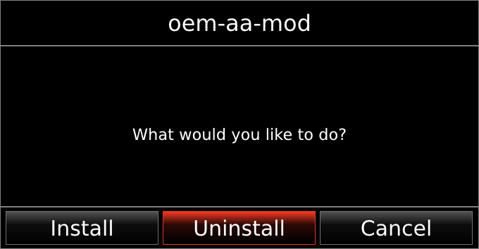
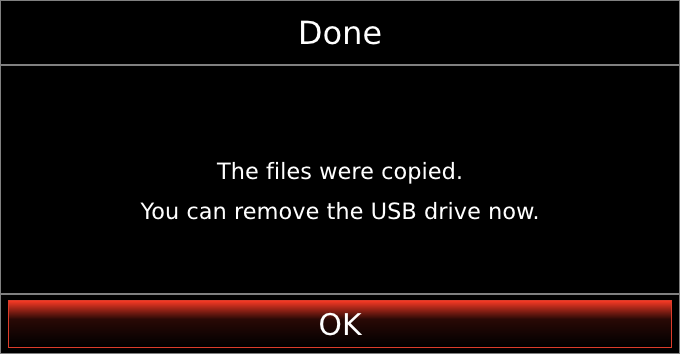
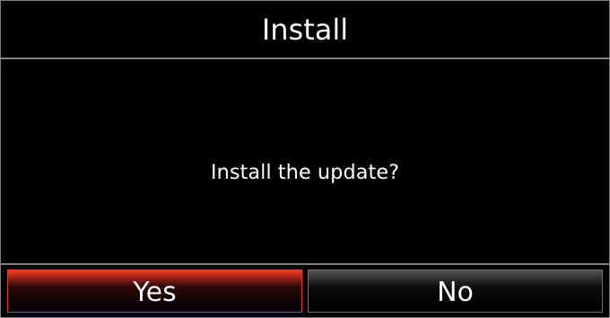
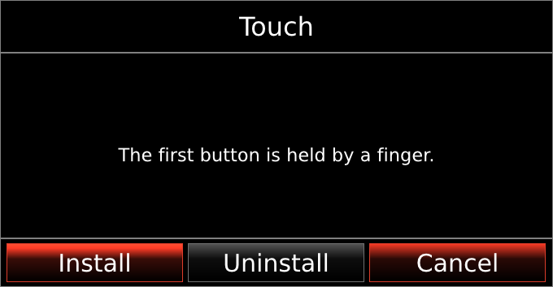
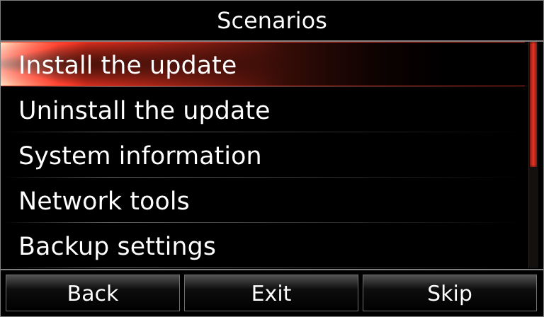
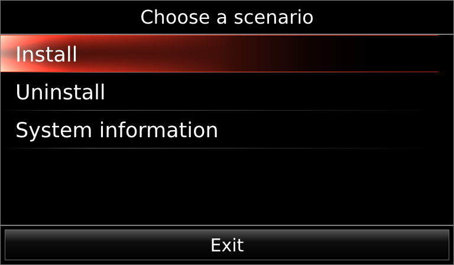
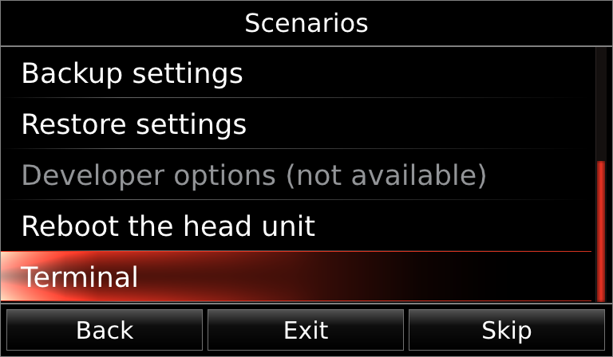
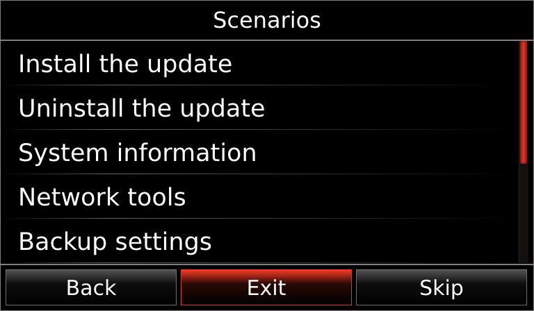
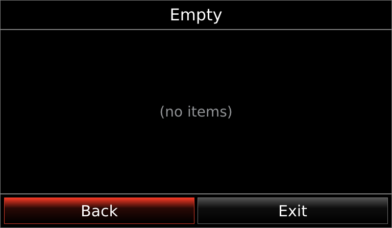

# mzd-utils

# mzd-dlg - a dialog window for the CMU

`mzd-dlg` shows a window with a **title**, a **text** and **1 to 3 buttons**, waits for the user and tells the calling `sh` script
**which button was pressed** (through the exit code). It is a drop-in replacement for the stock `/jci/tools/jci-dialog` (the same
options), with one big difference: the stock dialog works with touch only, `mzd-dlg` also works with the **commander knob** and a
**USB keyboard**.



_(The pictures in this documentation are rendered on a PC with the DejaVu font. On the CMU the font is Tipperary, a little narrower.)_

- The window is 680 x 354 pixels, in the middle of the 800 x 480 screen, like the stock dialog.
- One font (Tipperary) in all sizes: the title is large, the text and the buttons are smaller. No bold text, no letter spacing, and a text that does not fit is cut with `...` (never squeezed).
- The focused button is red; a button held by a finger is brighter.
- While the window is open the knob is grabbed, so the CMU behind it does not react. When the program ends, the knob works again.

## How it is controlled

| Input | What happens |
| --- | --- |
| rotate the knob, tilt it left / right / up / down | the focus moves to the next / previous button (around) |
| press the knob, USB Enter or Space | the focused button is chosen |
| **Back**, **Home** (commander), USB Esc | the "back" button is chosen: the one set with `--back-code`, by default **the last button** |
| touch | tap a button |

## The result: the exit code

| Exit code | Meaning |
| --- | --- |
| `0`, `1`, `2` | the **first**, **second**, **third** button (counting from the left) was chosen |
| `254` | nobody answered: `--timeout` (or `--max-seconds`) expired; the window is closed |
| `255` | the window could not be shown (no Wayland / IVI); the script should fall back to `jci-dialog` |

Nothing is printed to stdout.

## Parameters

All parameters are optional and are written as `--name=value`.

**Kind of window** (sets the default title, text and buttons; the options below change them):

| Parameter | Buttons | Default title / text |
| --- | --- | --- |
| `--info`, `--warning`, `--error` | one: `OK` | `Information` / `Warning` / `Error` and a short text |
| `--question` | two: `Yes`, `No` | `Question` |
| `--confirm` | two: `OK`, `Cancel` | `Confirmation` |
| `--3-button-dialog` | three: `OK`, `Cancel`, `No Default` | `Information` |
| `--no-cancel` | leaves only the first button | - |
| (nothing) | two: `OK`, `Cancel` | `Information` |

**Content:**

| Parameter | Meaning |
| --- | --- |
| `--title=TEXT` | the title at the top. A title that is too long is cut and ends with `...` |
| `--text=TEXT` | the text in the middle. Write `\n` for a new line (up to 6 lines). A line that is too long is cut and ends with `...` |
| `--ok-label=TEXT` | the label of the first button |
| `--cancel-label=TEXT` | the label of the second button |
| `--button3-label=TEXT` | the label of the third button (only with `--3-button-dialog`) |

**Behaviour:**

| Parameter | Default | Meaning |
| --- | --- | --- |
| `--default=N` | `0` | the button that has the focus when the window opens (0 = the first) |
| `--back-code=N` | the last button | the button that Back / Home / Esc choose (0 = the first) |
| `--timeout=SEC` | none | close the window after SEC seconds without an answer (exit code 254) |
| `--max-seconds=SEC` | `900` | a hard limit that always applies, so the knob can never stay grabbed. Keep it larger than `--timeout` |
| `--rot-step=N` | `1` | how many knob "clicks" move the focus by one button |
| `--no-grab` | off | do not grab the knob (the CMU behind the window reacts too) |

**Other / for developers:**

| Parameter | Meaning |
| --- | --- |
| `--name=NAME` | the name of the window in the compositor (default `mzd-dlg`); change it only if two windows must be open at the same time |
| `--evdev=FILE` | read this input device instead of looking for the knob (for tests); `--evdev-usb=FILE` the same, as a USB keyboard |
| `-v` | write a log to stderr |
| `--version`, `--help` | print the version / the options |

## Examples

### 1. A message

```sh
/tmp/mzd-dlg --info --title="Done" --text="The files were copied.\nYou can remove the USB drive now." --timeout=15
```



One button. The window closes by itself after 15 seconds (exit code `254`) or when the user presses OK (exit code `0`).

### 2. A choice of three actions

```sh
/tmp/mzd-dlg --3-button-dialog --title="oem-aa-mod" --text="What would you like to do?" \
  --ok-label="Install" --cancel-label="Uninstall" --button3-label="Cancel" --default=1
case $? in
  0) echo "Install" ;;
  1) echo "Uninstall" ;;
  *) echo "Cancel, Back, Home or nobody answered" ;;
esac
```


`--default=1` puts the focus on `Uninstall`. Back / Home on the commander choose the last button (`Cancel`, exit code `2`).

### 3. Yes / No

```sh
if /tmp/mzd-dlg --question --title="Install" --text="Install the update?"; then
  echo "yes"        # exit code 0 = the first button, Yes
else
  echo "no, Back or timeout"
fi
```



A button held by a finger (touch) looks like this (the first button here; the focus is on the third):



## Use from the `mzd-lib` scripts

In the scripts of `../mzd-lib` use `mzd_ask`, `mzd_choice`, `mzd_info` and `mzd_bye` instead of calling the program: they start it,
wait with a time limit and use the stock `jci-dialog` when `mzd-dlg` is not available (see `../mzd-lib/README.md`).


# mzd-listmenu - a scrollable list menu for the Mazda CMU

`mzd-listmenu` shows a window with a **title**, a **list of items** and a row of **buttons** under the list, waits for the user and
tells the calling `sh` script **what was chosen**. It is made for menus with many entries (for example the scenarios of a USB drive).



_(The pictures in this documentation are rendered on a PC with the DejaVu font. On the CMU the font is Tipperary, a little narrower.)_

- **The program never runs anything.** It only prints what the item means (its *value*) and ends. What to do with it is decided by
  the `sh` script.
- The list shows **5 rows** at a time. If there are more items, the list scrolls and a **red scroll bar** appears at its right.
  The **buttons stay in place** whatever the scrolling.
- The look is that of the lists of the CMU itself: a thin line under every row, the focused row has a red glow.
- An item can be **disabled**: it is shown in grey like in the CMU lists, never gets the focus and cannot be chosen.
- The window is 768 x 448 pixels with a 16 pixel margin (the status bar of the CMU stays visible). While it is open the knob is
  grabbed, so the CMU behind it does not react. When the program ends, the knob works again.
- Only Latin letters (the font of the CMU). Up to 1000 items. A name that is too long is cut with `...`.

## How it is controlled

| Input | What happens |
| --- | --- |
| rotate the knob | the focus goes to the next / previous item; after the last item to the buttons; then around to the first item |
| tilt up / down | previous / next item. Tilt down from the last item goes to the buttons, tilt up from a button goes back to the list |
| tilt left / right | in the list: one page (5 items) up / down. On the buttons: the neighbour button |
| press the knob, USB Enter | choose the focused item, or press the focused button |
| **Back**, **Home** (commander), USB Esc | press the "back" button: the one set with `--back-button`, by default **the last button** |
| touch | tap an item or a button. Drag the list with a finger to scroll it, drag the red bar, or tap on the bar track above / below the thumb to scroll by a page |
| USB keyboard | the arrows, PgUp / PgDn, Home / End (first / last item), a **letter** jumps to the next item that starts with it |

Disabled items are skipped by all of this.

## The result

| Exit code | stdout | Meaning |
| --- | --- | --- |
| `0` | the item's value (see `--print`) | an item was chosen |
| `1`, `2`, `3`, `4` | nothing | the **first**, **second**, ... button was pressed (counting from the left) |
| `254` | nothing | nobody answered: `--timeout` (or `--max-seconds`) expired |
| `255` | nothing | the window could not be shown, or a wrong option |

The exit code of the buttons is the number **plus one** (0 is taken by "an item was chosen").

## Parameters

All parameters are optional and are written as `--name=value`.

**The title and the buttons:**

| Parameter | Default | Meaning |
| --- | --- | --- |
| `--title=TEXT` | `Menu` | the title at the top |
| `--button=TEXT` | one button `Exit` | a button under the list. Repeat the parameter for more buttons (up to 4); they are shown left to right |
| `--back-button=N` | the last button | the button that Back / Home / Esc press (0 = the first) |

**The items** (use one of the two ways, or both):

| Parameter | Meaning |
| --- | --- |
| `--item=NAME` | an item with this name. Its value is the name unless `--value` follows |
| `--value=VALUE` | the value of the item named just before (what is printed when it is chosen) |
| `--disabled` | makes the item named just before disabled |
| `--items-file=FILE` | items from a file, one per line: `NAME`, or `NAME<TAB>VALUE`, or `NAME<TAB>VALUE<TAB>disabled`. The columns are separated by the TAB character; an empty VALUE means "same as the name"; empty lines and lines starting with `#` are ignored |

**Which item has the focus and what is printed:**

| Parameter | Default | Meaning |
| --- | --- | --- |
| `--focus=N` | `0` | the item (counting from 0) that has the focus when the window opens; the list is scrolled to show it. If it is disabled, the nearest enabled item is taken. Use it to come back to the item chosen last time |
| `--focus-button=N` | - | start with the focus on this button (0 = the first) instead of an item |
| `--print=WHAT` | `value` | what is printed on stdout when an item is chosen: `value`, `name`, `index` (its number from 0) or `both` (the index, a TAB character and the value) |

**Behaviour:**

| Parameter | Default | Meaning |
| --- | --- | --- |
| `--timeout=SEC` | none | close the window after SEC seconds without an answer (exit code 254) |
| `--max-seconds=SEC` | `900` | a hard limit that always applies, so the knob can never stay grabbed. Keep it larger than `--timeout` |
| `--rot-step=N` | `1` | how many knob "clicks" move the focus by one step |
| `--no-grab` | off | do not grab the knob (the CMU behind the window reacts too) |

**Other / for developers:**

| Parameter | Meaning |
| --- | --- |
| `--name=NAME` | the name of the window in the compositor (default `mzd-listmenu`) |
| `--evdev=FILE`, `--evdev-usb=FILE` | read this input device instead of looking for the knob (for tests); the second one is treated as a USB keyboard |
| `-v` | write a log to stderr |
| `--version`, `--help` | print the version / the options |

## Examples

### 1. A short menu with the items on the command line

```sh
VALUE=$(/tmp/mzd-listmenu --title="Choose a scenario" \
          --item="Install"            --value="install.sh" \
          --item="Uninstall"          --value="uninstall.sh" \
          --item="System information" --value="info.sh" \
          --button="Exit")
case $? in
  0) sh "$VALUE" ;;        # an item was chosen: run the script that its value names
  1) echo "Exit" ;;        # the button Exit
  *) echo "nobody answered" ;;
esac
```



The user turns the knob and presses it on "Uninstall": `$VALUE` is `uninstall.sh`, the exit code is `0`.
If the user presses Back or Home, the last button is pressed: here the exit code is `1`.

### 2. A long menu from a file, with a disabled item and three buttons

The file `scenarios.txt` (the columns are separated by a TAB character):

```
Install the update	install.sh
Uninstall the update	uninstall.sh
System information	info.sh
Network tools	net.sh
Backup settings	backup.sh
Restore settings	restore.sh
Developer options (not available)	dev.sh	disabled
Reboot the head unit	reboot.sh
Terminal	terminal.sh
```

```sh
TAB=$(printf '\t')
FOCUS=0
while :; do
  OUT=$(/tmp/mzd-listmenu --title="Scenarios" --items-file=scenarios.txt \
          --button="Back" --button="Exit" --button="Skip" \
          --print=both --focus="$FOCUS")
  RC=$?
  [ "$RC" -ne 0 ] && break                    # a button (1, 2, 3) or nobody answered: leave the loop
  FOCUS=${OUT%%"$TAB"*}                       # the number of the chosen item: the menu comes back on it
  VALUE=${OUT#*"$TAB"}                        # its value
  sh "$VALUE"                                 # run it, then show the menu again
done
```

Nine items do not fit in 5 rows, so the red scroll bar is shown. With `--focus=0` the list starts at the top:


When the user moves down, the list scrolls. The "Developer options" row is grey and the focus skips it:



The focus can also be on a button (here `--focus-button=1`, the button Exit):



A list without items shows "(no items)"; the buttons still work:



## Use from the `mzd-lib` scripts

`mzd_menu TITLE FILE [BUTTON...]` in `../mzd-lib` does the work of example 2 for you: it starts the program with a time limit and sets
`MZD_MENU_INDEX` and `MZD_MENU_VALUE`. See `../mzd-lib/README.md` and `../scenarios/recon-terminal-10.sh`.

